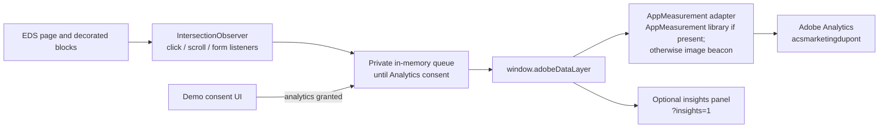

# DuPont — Adobe Analytics Build Guide

_Analytics implementation guide for the DuPont Edge Delivery Services demo in
this repository. Adapted from the Parker Analytics Build Guide to match the
DuPont EDS implementation and its actual event names and transport._

> **Scope:** this guide describes the EDS demo, not the public
> `www.dupont.com` Tags implementation. The demo config uses report suite
> `acsmarketingdupont` and sends directly through its AppMeasurement adapter.
> The public production site separately loads Adobe Tags, AppMeasurement, and
> Target code. Do not enable both collection paths on the same route without
> explicit deduplication and report-suite approval.

## 1. Architecture overview

The EDS instrumentation observes decorated blocks, records consent-gated
events in `window.adobeDataLayer`, and sends them through the configured
transport. The optional insights panel subscribes to that same event stream;
it does not create a second collection path.



The delayed entry point (`scripts/delayed.js`) starts analytics, then the
optional insights panel, then initializes the consent UI. Before consent,
events remain in memory; declining drops the queued events and does not start
the transport.

## 2. Demo configuration

Configuration lives in `scripts/analytics-config.js`:

| Setting | Demo value | Notes |
|---|---|---|
| Transport mode | `appmeasurement` | Selected because a report suite and tracking server are configured. |
| Report suite | `acsmarketingdupont` | Demo RSID supplied for this port. Runtime collection was observed in the branch preview; Adobe Workspace access was not used to verify processing. |
| Tracking server | `acsmarketing.sc.omtrdc.net` | The demo collection host. The public production Tags library exposes a separate `dupont.d2.sc.omtrdc.net` value; do not substitute it without Adobe Analytics owner approval. |
| Org ID | `21BD487E5F2280130A495ECC@AdobeOrg` | Public client-side identifier. |
| AppMeasurement URL | `/deps/appmeasurement/AppMeasurement.min.js` | Optional local library. If unavailable, the adapter builds a documented Analytics image request. The tested preview used beacon mode. |
| Web SDK datastream | empty | Web SDK adapter is present but dormant. |

Metadata can override configuration per page using `analytics-*` metadata.
`analytics=off` disables analytics for that page. `analytics-mode=debug` is a
testing override.

## 3. Success events

| Event | Analytics event | Trigger |
|---|---|---|
| Component Impression | `event1` | A block enters the configured IntersectionObserver visibility threshold, once per observed block. |
| CTA Click | `event2` | A click on an in-content link or button. |
| Navigation Click | `event2` | A click in the header or footer. |
| Download | `event3` | Click on a link whose file extension matches the download list in `scripts/analytics.js`. |
| Form Start | `event4` | First focus in a form. |
| Form Submit | `event5` | Form submit event or a successful Marketo callback. |
| Scroll Milestone | `event6` | First reach of 25%, 50%, 75%, or 100% page depth. |
| Page View | no named success event | Sends an AppMeasurement page-view hit via the `s.t()` path or equivalent beacon. |
| Consent Update | not sent as an Analytics hit | Internal event for consumers; transports explicitly ignore it. |

## 4. Variable mapping

The authoritative implementation is `toAnalyticsVars()` in
`scripts/analytics-transport/appmeasurement.js`.

| Analytics variable | Name | Value |
|---|---|---|
| `eVar1` | Template | `page.template`, from `template` metadata or `default`. |
| `eVar2` | Locale | First URL path segment when it resembles a locale; otherwise `en`. |
| `eVar3` / `prop3` | Component ID | Block name plus any variants, joined with `|` (for example `cards|products`). |
| `eVar4` / `prop4` | Block Name | Component/block name. |
| `eVar5` | Position | Position assigned on first component description in the page session. |
| `eVar6` | Section Index | EDS section ordinal for the block; zero when no section ancestor exists. |
| `eVar10` | Link Text | Readable link or button label. |
| `eVar11` | Link URL | Resolved link URL. |
| `eVar12` | Download File | Download filename. |
| `eVar13` | Scroll Depth | Milestone as a percentage string. |
| `eVar14` | Form Name | Form/block name. |
| `prop1` | Page Path | Current pathname. |
| `prop10` | Region : Link Type | `<header|main|footer>:<link type>`. |
| `events` | Success events | `event1`–`event6` according to the event table. |
| `pageName` | Page Name | `og:title`, document title, or pathname. |
| `channel` | Site Section | Second non-empty URL path segment, or `home`. |

Link-level and component variables are sent on the associated interaction hit.
Empty and undefined values are omitted from the beacon query. The fallback
first-party visitor identifier uses localStorage key
`dupont-analytics-vid`; when a `Visitor` instance already exists, its ECID is
used instead.

## 5. Data-layer contract

The global array is the join point between instrumentation, the transport, and
the live panel:

```js
{
  event: 'block-view',
  eventInfo: { timestamp: '2026-10-21T00:00:00.000Z', path: '/en/' },
  page: {
    name: 'Home | DuPont',
    path: '/en/',
    url: 'https://example.test/en/',
    locale: 'en',
    template: 'default',
    siteSection: 'home',
    sectionCount: 4
  },
  component: {
    name: 'cards',
    variants: ['products'],
    id: 'cards|products',
    sectionIndex: 2,
    position: 3
  }
}
```

Other payloads include `link`, `download`, `scroll`, `form`, and optional
`component.attributes` properties. Events observed before consent are kept in a
private in-memory queue and only pushed to `window.adobeDataLayer` after
Analytics consent is granted.

## 6. Consent, Target, and insights

- Consent storage uses DuPont-specific keys `dupont-consent` and
  `dupont_consent`; the banner provides Accept, Reject, and Preferences.
- Analytics transport starts only when the `analytics` consent category is
  true. Rejection drops queued events. A later change to a denied state stops
  further collection.
- The `personalization` category exists in the demo consent model, but it is
  **not currently connected to the existing Target loader**. The Target offer
  rendered before consent in preview. This is a demo limitation and a policy
  decision to resolve before production use; do not infer that the banner gates
  Target.
- Insights is mounted only when enabled with `?insights=1` (remembered in
  sessionStorage under `dupont-insights`). Shift+Alt+I toggles the panel.
  It reads the same `adobeDataLayer` stream and computes its summaries in the
  browser; it sends no separate analytics hits.

## 7. Validation checklist

- [ ] Confirm the approved RSID, tracking server, and report-suite processing
  with the Adobe Analytics owner; runtime beacon visibility alone does not
  prove Workspace configuration.
- [ ] On a fresh browser context, confirm the consent banner appears and no
  Analytics collection request is sent before a decision.
- [ ] Accept Analytics consent; confirm page-view and visible block events are
  present and that requests target `/b/ss/acsmarketingdupont/`.
- [ ] Reject Analytics consent; reload and confirm the choice persists and no
  `/b/ss/acsmarketingdupont/` request is sent.
- [ ] Exercise an in-content CTA, header/footer link, downloadable asset, form,
  and each reachable scroll milestone; verify the mapped `events`, eVars, and
  props on the corresponding hits.
- [ ] Open `?insights=1`; confirm the panel reflects the same events and that
  it is absent for visitors without the explicit opt-in.
- [ ] Verify `?p=0`, `?p=3`, and `/en/target` in both consent states.
- [ ] Decide how DuPont's approved CMP categories should govern Adobe Target;
  the current demo does not gate Target on `personalization`.
- [ ] Check that a page with `analytics=off` does not start analytics.

## 8. Related guides

- [Current-state architecture](architecture/current-state-architecture.md)
- [Target-state architecture](architecture/target-state-architecture.md)
- [Parker Analytics Build Guide](https://github.com/ynaka-adobe/parker/blob/main/docs/analytics-build-guide.md)

