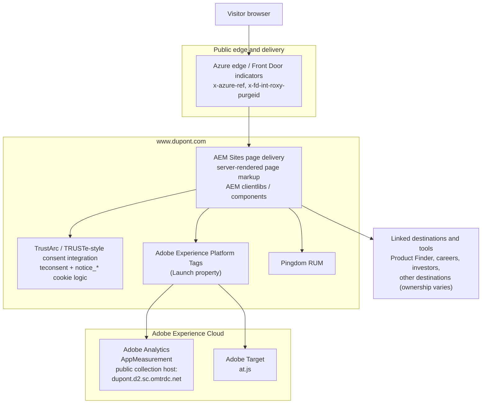

# DuPont — Current-State Web Architecture (Observed)

_Reverse-engineered from public, client-visible page source, response headers,
and browser-delivered JavaScript. No internal documentation or credentials
were used. Last reviewed: 2026-10-21._

## Diagram

## Component notes and evidence

| Layer | Observed component | Role / evidence |
|---|---|---|
| Edge | Azure edge indicators | The homepage response includes `x-azure-ref` and `x-fd-int-roxy-purgeid`. These indicate Microsoft/Azure edge infrastructure; the exact routing and origin configuration are not publicly established here. |
| Web | AEM Sites | The page exposes AEM paths such as `/etc.clientlibs/dupont-foundation/...`, `/etc.clientlibs/dupont-applications/...`, `/etc/cloudsettings.kernel.js/...`, AEM grid classes, and a `template` value of `corporate-home-page-template`. HTML includes rendered content and component markup. |
| Web | AEM client libraries | The page loads Foundation, Corporate, campaign, and header/footer client libraries from `/etc.clientlibs/`. This is consistent with an AEM-rendered component site; public evidence does not establish the exact AEM version or hosting tier. |
| Consent | TrustArc / TRUSTe-style integration | Public page code includes a `#teconsent` mount point and logic referencing `notice_gdpr_prefs` and `notice_behavior`. The Launch bundle also configures opt-in behavior. The exact category mapping and consent behavior by region were not confirmed. |
| Tag management | Adobe Experience Platform Tags (Launch) | The homepage loads the public Adobe Tags library at `assets.adobedtm.com/.../launch-025f15007675.min.js`. |
| Analytics | Adobe Analytics / AppMeasurement | The downloaded Launch library contains AppMeasurement code and a tracking-server configuration for `dupont.d2.sc.omtrdc.net`. The production report suite ID and Workspace configuration were not established from the homepage evidence. |
| Personalization | Adobe Target / at.js | The Adobe Tags library contains `at.js` and Adobe Target runtime code. This confirms the library is present in the public client-side bundle; it does not reveal the full activity, audience, or consent policy. |
| Performance | Pingdom RUM | The page loads `rum-static.pingdom.net` scripts. |
| Destinations | Separate linked journeys | The public site links to Product Finder, careers, investor relations, and other destinations. Their backend ownership and integration contracts are outside the scope of this observation. |

## Interpretation

The public DuPont corporate homepage is delivered as an AEM Sites experience
with AEM client libraries and rendered page markup. Adobe Tags adds Analytics
and Target browser libraries, while a consent integration is present in the
page. The public edge headers indicate Azure edge infrastructure.

This is a client-side view only. It does not prove whether production AEM is
Cloud Service or a self-managed deployment, identify the origin topology, or
confirm the configuration of individual Analytics report suites, Target
activities, consent categories, or linked applications.

## Open questions for DuPont

- Which AEM deployment tier and author/publish topology serve the corporate
  properties?
- Which paths and applications are in scope for an EDS pilot, and which must
  remain on their current runtime?
- Which consent vendor/category is authoritative for Analytics and
  personalization on each relevant property and region?
- Which Adobe Analytics report suite receives production hits, and what
  collection domain and governance apply?
- Which system owns Product Finder, identity, product data, and other linked
  journeys?

## Public evidence

- [DuPont homepage](https://www.dupont.com/)
- [DuPont robots.txt](https://www.dupont.com/robots.txt)
- [Adobe Tags library observed on the homepage](https://assets.adobedtm.com/21fa3c337531/9dd4b1d7bd35/launch-025f15007675.min.js)

