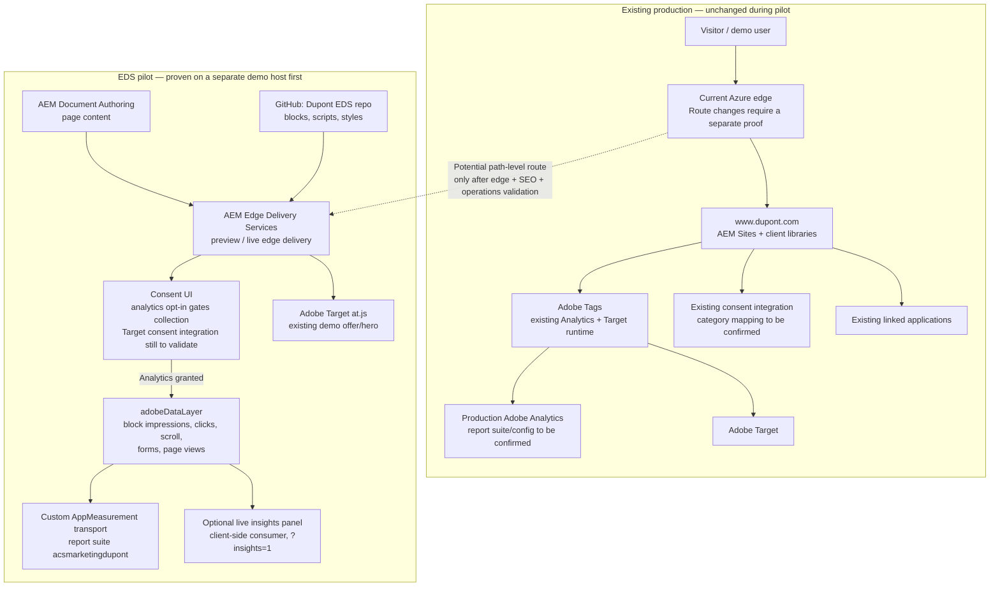

# DuPont — Target-State Architecture (Proposed)

_A route-level EDS pilot informed by the running DuPont demo in this repository.
This is a proposal for validation, not a committed migration roadmap. Drafted
2026-10-21._

## Intent

Use the demo to validate Edge Delivery Services for a bounded set of
content-oriented pages while keeping the observed production AEM site, its
Adobe Tags property, and linked applications in place. Do not assume that the
whole DuPont site should move to EDS.

Initially, the demo remains on its own EDS host. A same-domain, path-level
route through DuPont's existing edge is a later proof point: the public headers
suggest Azure edge infrastructure, but do not prove that it is configured or
approved to route to an EDS origin.

## Diagram

## What the current demo proves

- EDS page code is maintained in GitHub while page content is sourced from
  AEM Document Authoring.
- The demo uses generic block-aware tagging: EDS block markup emits page-view,
  block impression, click, download, scroll, and form events into
  `window.adobeDataLayer`.
- The AppMeasurement adapter is configured for `acsmarketingdupont`; in the
  tested preview it sent collection requests to
  `acsmarketing.sc.omtrdc.net` after Analytics consent was granted.
- The consent choice persists, and rejecting Analytics consent prevents those
  analytics collection requests.
- The optional insights panel reads the same in-browser event stream and is
  explicitly enabled with `?insights=1`.
- The `/en/target` demo page renders an Adobe Target offer with overlay text.

These are demo observations, not production readiness or a guarantee of
equivalent production configuration.

## Consent and Target decision

The demo's consent banner currently gates Analytics only. Its
`personalization` category is not wired to the existing Target loader: the
Target offer rendered before the visitor made a choice in the preview test.
This behavior is not represented as a completed consent integration.

Before using the pattern in production, DuPont's privacy and marketing owners
should decide how the authoritative consent platform gates Analytics and
personalization. If policy requires it, integrate the approved CMP state with
Target before loading at.js or requesting an offer. Do not treat the demo banner
as a replacement for DuPont's current consent system.

## Proposed validation sequence

1. **Bounded preview:** keep the EDS demo on a separate host; validate content
   authoring, responsive rendering, accessibility, page performance, analytics,
   consent, and Target offer rendering.
2. **Measurement alignment:** decide whether the demo suite
   `acsmarketingdupont` remains separate or is replaced by an approved suite.
   Prevent duplicate collection if Adobe Tags and the direct AppMeasurement
   adapter coexist on any route.
3. **Consent alignment:** map approved consent categories to Analytics and
   Target independently, then test accept, reject, withdrawal, and persistence.
4. **Route pilot:** only if DuPont's edge owners approve, route one selected
   content template to EDS while keeping the current AEM route available for
   rollback. Verify canonical URLs, redirects, caching, monitoring, and
   operational ownership.
5. **Expand by evidence:** consider additional page types only after the pilot
   meets agreed business, security, performance, accessibility, and analytics
   criteria.

## Decisions / proof points still needed

| Topic | Proof point |
|---|---|
| Edge routing | Demonstrate a selected route can reach EDS through an approved edge configuration without changing unrelated AEM paths. |
| Content operations | Confirm authoring roles, publication workflow, preview/live ownership, and rollback for EDS content. |
| Analytics continuity | Confirm the intended report suite, identity treatment, data governance, and deduplication against the current Tags property. |
| Consent | Confirm the CMP source of truth, regional behavior, and category-specific behavior for Analytics and Target. |
| Target | Validate the demo offer/activity, audience, and consent behavior against DuPont's intended personalization policy. |
| Linked apps/data | Identify any APIs or product/identity services needed by a pilot page; do not infer or replace those systems from the public site alone. |

## Explicit non-goals

- This proposal does not recommend migrating all of `www.dupont.com`.
- It does not replace AEM Sites, the current Adobe Tags property, or linked
  applications.
- It does not assume the demo report suite is the production report suite.
- It does not claim the EDS code or demo consent UI is production-approved.

